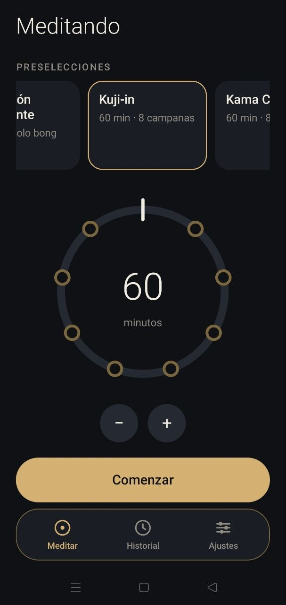
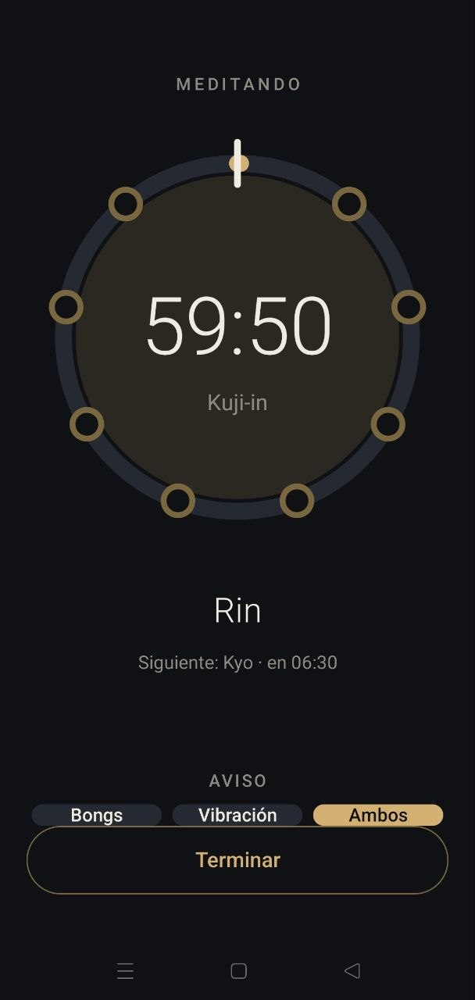
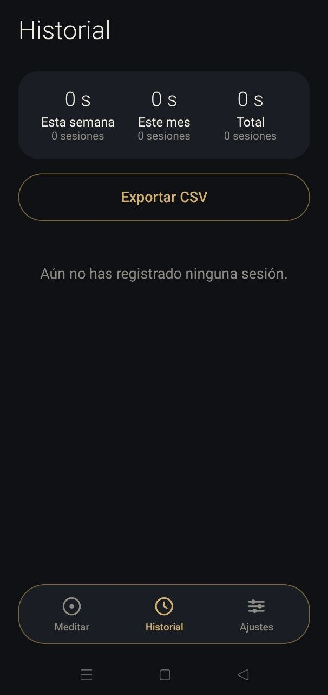
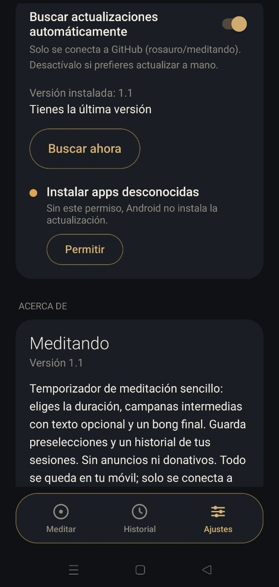
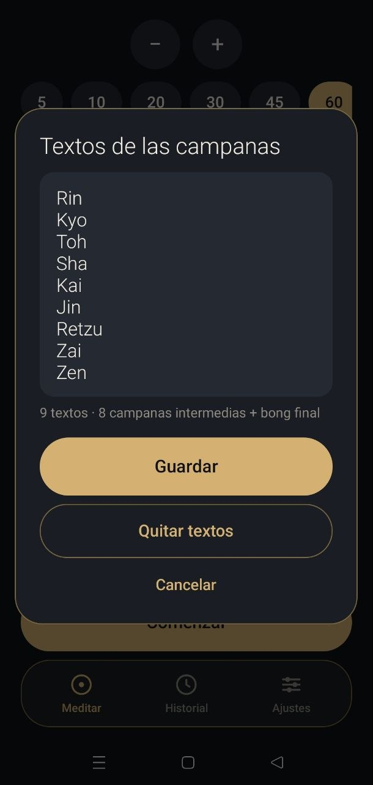
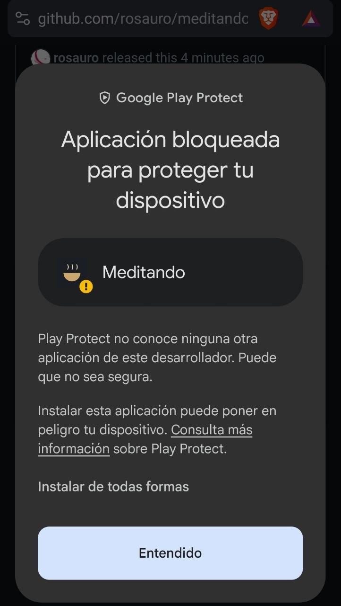
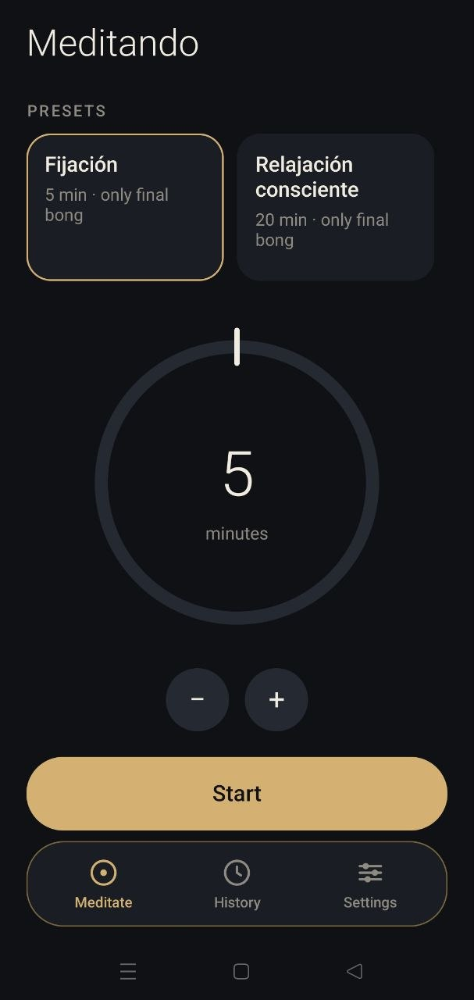
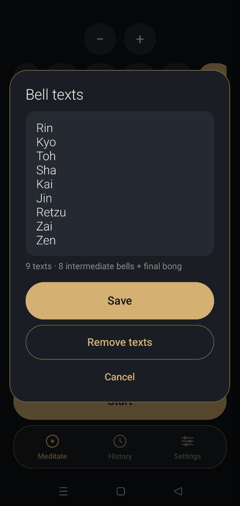

# Meditando

**Español** · [English](#english)

Un temporizador para meditar en Android. Sin anuncios, sin cuentas y sin donativos.

  
  
  
  
  

## Cómo funciona

1. **Elige cuánto tiempo** quieres meditar (por ejemplo, 20 minutos).
2. **Elige las campanas** (opcional): si quieres que suenen avisos suaves por el camino, por ejemplo 9 en una hora para cambiar de postura. Si no, solo sonará el **bong final**.
3. **Pulsa «Comenzar»** y deja el móvil: suena aunque la pantalla esté apagada.

Más cosas, si las quieres:

- **Textos en las campanas.** Pega una lista (una por línea) y cada campana mostrará su texto, por ejemplo un mantra. La app calcula sola cuántas campanas necesita.
- **Preselecciones.** Guarda tus meditaciones favoritas para repetirlas con un toque.
- **Historial.** Mira cuánto has meditado esta semana, este mes y en total.
- **Aviso.** Elige si avisa con sonido, vibración o ambos, y el volumen.
- **Idioma.** Español (por defecto) o inglés, en Ajustes.

## Instalar

1. Entra en [Releases](https://github.com/rosauro/meditando/releases/latest) y descarga el archivo `.apk`.
2. Ábrelo en el móvil. Android te pedirá permiso para «instalar apps desconocidas»: acéptalo.
   - **Si Google Play Protect dice «Aplicación bloqueada»**: es normal en una app nueva de un desarrollador que no conoce. Pulsa **«Más detalles»** y luego **«Instalar de todas formas»**. El código es abierto, puedes revisarlo en este repositorio.

3. Abre la app, ve a **Ajustes → Fiabilidad** y deja todo en verde para que suene con la pantalla apagada.

Necesita Android 8.0 o superior.

## Actualizaciones

La app mira de vez en cuando si hay una versión nueva en este repositorio y te avisa o la instala. Puedes desactivarlo en **Ajustes → Actualizaciones**.

## Privacidad

Todo se queda en tu móvil. No hay anuncios ni seguimiento. Solo usa internet para buscar actualizaciones.

## Licencia

[GPL-3.0](LICENSE). Para compilarla tú mismo: `./gradlew assembleDebug` (necesitas el Android SDK).

---

## English

A simple meditation timer for Android. No ads, no accounts, no donations.

  
  
  

### How it works

1. **Pick how long** you want to meditate (e.g. 20 minutes).
2. **Pick the bells** (optional): soft reminders along the way, e.g. 9 in one hour to change posture. Otherwise only the **final bong** rings.
3. **Tap "Start"** and put the phone down: it rings even with the screen off.

Extras: a **text for each bell** (paste a list, one per line, e.g. mantras), **presets** for your favourite sessions, a **history** (week, month, total), alert mode (**sound, vibration or both**) and **Spanish or English** in Settings.

### Install

1. Go to [Releases](https://github.com/rosauro/meditando/releases/latest) and download the `.apk`.
2. Open it on your phone and allow "install unknown apps".
   - **If Google Play Protect says "App blocked"**: that is normal for a new app from a developer it does not know. Tap **"More details"** and then **"Install anyway"**. The code is open source, you can review it in this repository.
3. In **Settings → Reliability**, turn everything green so it rings with the screen off.

Requires Android 8.0+. The app checks this repository for new versions now and then (can be turned off in Settings → Updates). Everything stays on your phone; the internet is only used to check for updates.

License: [GPL-3.0](LICENSE).
